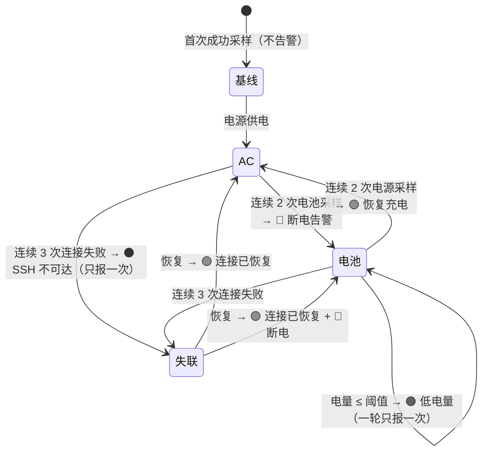

# BattMate ⚡🔋

**在菜单栏实时监控另一台 Mac 的充电状态 —— 充电器断开，1 分钟内知晓。**


一台 Mac 合盖当服务器 7×24 跑着，充电器接触不良、悄悄松脱，机器靠电池撑到耗尽关机，SSH 服务随之中断——而你毫无察觉。**BattMate 就是为这个场景写的**：在你的主力 Mac 菜单栏常驻一个图标，实时显示服务器机的充电状态与 CPU / 内存占用，断电、低电量、失联立刻弹系统通知。顺带把常驻 SSH 端口隧道也收进来：多组「本机端口 → 服务器端口」由 autossh 自动保活。

## 功能特性

- 📊 **菜单栏实时状态**：SF Symbol 闪电 / 电池图标 + 电量数字，绿色（电源供电）/ 橙色（电池供电）/ 灰色警告（SSH 失联，失败期间闪烁）
- 📈 **CPU / 内存监控**：菜单实时显示服务器 CPU 与内存使用率（按负载变色）；点击任一项打开性能面板——最近趋势折线图 + CPU Top 10 进程（每 5 秒刷新）
- 🗜️ **64 KB 本地趋势**：每次采样追加到本机 `metrics-history.txt`，严格不超过 64 KB，写满自动剔除最旧数据；每 30 秒一条，约可保留最近 52 小时（2.2 天）
- 🔌 **多端口 SSH 隧道**：配置「本机端口 → 服务器端口」即常驻 `autossh` 本地转发，断线自动重连、异常退出退避重启
- 📡 **隧道状态可见**：菜单中逐条显示彩色状态点：绿色运行中 / 橙色重连中 / 红色失败 / 灰色停用，可一键重启全部隧道
- 🎛️ **现代设置面板**：侧边栏分区 + 玻璃拟态卡片，浅色 / 深色自适应，SSH 测试与端口校验即时反馈
- 🧹 **退出即清理**：正常退出 App 会终止所有 autossh 进程并释放本地端口；隧道只监听 `127.0.0.1`，不暴露到局域网
- 🔔 **四类告警**（系统通知，同一状态只提醒一次，防骚扰）：
  - 🔴 充电器断开
  - 🟠 电量低于阈值（默认 20%，可配）
  - ⚫ SSH 连续 3 次连接失败
  - 🟢 恢复充电 / 连接恢复
- 🛡️ **防抖设计**：电源切换需连续 2 次采样确认——针对「接触不良」这种充电器在通断间抖动的故障模式，不会通知风暴
- 🚀 **轻量无感**：轮询走 SSH 连接复用，开销极低；主机睡眠自动暂停轮询、唤醒立即补测
- 📦 **部署即拷贝**：单个 `.app`，服务器机**零依赖**（`pmset` 系统自带，免 sudo）
- 💤 支持开机自启（SMAppService）

## 工作原理

```mermaid
flowchart LR
    subgraph A["主力 Mac（运行 BattMate）"]
        S[PollScheduler<br/>每 30s 触发] --> R[SSHBatteryReader<br/>ssh + 超时看门狗]
        R --> P[PMSetOutputParser<br/>电量解析]
        R --> Q[SystemUsageParser<br/>CPU / 内存解析]
        P --> E[AlertEngine<br/>告警状态机 + 防抖]
        Q --> H[MetricsHistoryStore<br/>64 KB 本地趋势]
        E --> N[Notifier<br/>系统通知]
        E --> U[StatusBarUI<br/>菜单栏]
        E --> J[(status.json<br/>为小组件预留)]
        U -.点击 CPU / 内存.-> W[PerformanceWindow<br/>折线图 + Top 10]
        H --> W
        W -.按需 / 每 5 秒.-> O[TopProcessReader<br/>ps -r Top 10]
        T[TunnelManager<br/>每端口一个进程] --> X[autossh × N]
        T --> U
    end
    A -- "SSH (ControlMaster 复用)" -->|"pmset + top / ps"| B[服务器 Mac<br/>合盖运行]
    A -- "SSH -L 本地转发" --> B
```

### 远端取数：一次 SSH，拿齐电量 / CPU / 内存

被监控机**不需要安装任何东西**。macOS 自带的 `pmset -g batt` 与 `top` 免 sudo 输出全部所需信息：

```
Now drawing from 'AC Power'
 -InternalBattery-0 (id=5400300)	98%; charging; 0:41 remaining until full
CPU usage: 3.4% user, 6.80% sys, 90.15% idle
PhysMem: 12G used (2737M wired, 884M compressor), 4409M unused.
```

每次轮询只建立一条 SSH 命令：`pmset -g batt`，然后 `top -l 2 -n 0 -s 1` 取第二次采样（第一次是开机以来的均值，第二次才是当前值）。解析出电源来源、电量、充放电状态、剩余时间、CPU 使用率与内存占用。`top` 失败不会连带丢失电量数据。

点击菜单中的 CPU 或内存行，都会打开性能面板：上半部分是所选指标的折线图（CPU / 内存可切换），右侧是 CPU Top 10 进程。进程列表按需执行 `ps -Ao pid=,pcpu=,pmem=,comm= -r` 获取，打开期间每 5 秒刷新，关闭窗口即停止请求。

### 64 KB 指标历史

每次成功采样都会把 CPU / 内存百分比追加到本机 `metrics-history.txt`：首行是基准时间戳，后续每行只存 `秒偏移,CPU,内存`（如 `30,12,68`）。文件严格不超过 64 KB，写满后从最旧的采样开始剔除。

按 30 秒采样实测平均每条约 10.5 字节：**64 KB 约容纳 6000 余条，覆盖最近约 52 小时（2.2 天）**。64 KB 对磁盘依旧可以忽略；若想保留一周以上，可继续调大 `MetricsHistoryStore.defaultMaxBytes`（256 KB ≈ 8.7 天，1 MB ≈ 35 天）。历史只存本机，不占服务器空间。

SSH 侧用 `BatchMode=yes`（绝不弹密码框）+ `ConnectTimeout=5` + `ControlMaster=auto/ControlPersist=60`（连接复用，后续轮询毫秒级）+ 12 秒看门狗（防悬挂）。

### 告警状态机（含防抖）



### SSH 端口隧道（autossh）

在设置窗口「SSH 隧道」中添加任意多条映射，例如「本机 8080 → 服务器 80」。保存后 App 会为每条启用的映射启动一个常驻进程：

```bash
autossh -M 0 -N \
  -o BatchMode=yes -o ExitOnForwardFailure=yes \
  -o ServerAliveInterval=30 -o ServerAliveCountMax=3 \
  -L 127.0.0.1:8080:127.0.0.1:80 <SSH 目标>
```

- 只绑定本机 `127.0.0.1`，不会把端口暴露到局域网
- 隧道断线由 autossh 自身守护；进程异常退出时，App 按 5s → 10s → 20s → 30s → 60s 退避重启
- 菜单栏逐条展示状态；SSH 的典型错误（端口占用、免密失败、超时等）会翻译成可读原因
- App 启动时自动建立；改配置后自动重建；正常退出时终止全部 autossh 并释放端口

`autossh` 只需装在运行 BattMate 的这台 Mac 上，服务器端无需安装：

```bash
brew install autossh
```

App 会依次在 Homebrew 常见路径（`/opt/homebrew/bin`、`/usr/local/bin`）、`/usr/bin`、`/opt/local/bin` 和当前 `PATH` 中探测 autossh。

## 技术栈

| 层 | 选择 | 说明 |
|---|---|---|
| 语言 | Swift 5.8 | 单语言全栈 |
| 菜单栏 | AppKit `NSStatusItem` | 常驻图标 + 下拉菜单，LSUIElement 无 Dock 图标 |
| 设置界面 | SwiftUI（自绘侧栏 + 玻璃卡片 + 自绘折线图） | 连接 / 隧道 / 告警三栏，性能面板浅色与深色自适应 |
| 资源监控 | `top` / `ps`（系统自带） | 轮询取 CPU / 内存；性能面板按需用 `ps -r` 拉 Top 10 |
| 通知 | `UNUserNotificationCenter` + `osascript` 兜底 | 双通道：UN 授权失败自动降级 AppleScript，转义经过单测 |
| 网络 | 系统 `ssh`（Process 调用） | 零第三方依赖，ControlMaster 复用连接 |
| SSH 隧道 | `autossh`（Process 调用） | 每条映射独立进程，`-M 0` + ServerAlive 守护，App 管生命周期 |
| 自启 | `SMAppService` | macOS 13+ 原生登录项 |
| 构建 | **swiftc 直编 + lipo** | 仅需 Command Line Tools，**不需要 Xcode** |
| 测试 | 自建轻量断言运行器 | `./test.sh` 一键编译运行 61 个单测，零警告 |

## 为什么这样设计（实现要点）

- **为什么是菜单栏而不是通知中心小组件？** WidgetKit 小组件刷新预算由系统控制，约 15~60 分钟才刷新一次——对「及时发现断电」完全不合格；且开发必须装 Xcode。菜单栏图标可秒级刷新、始终可见。状态数据仍落盘 `status.json`，为将来补小组件预留了数据接口。
- **为什么不用 SwiftPM？** 本项目开发机的 CLT 14.3.1 存在已知缺陷：缺少 `Platforms/MacOSX.platform`，SwiftPM 构建计划硬依赖的 `xcrun --show-sdk-platform-path` 在 CLT 模式下永不提供，`swift build`/`swift test` 一律硬失败且无升级可用。改用 `swiftc -sdk $(xcrun --show-sdk-path)` 直编，构建脚本两次编译（x86_64 + arm64 交叉编译）后 `lipo` 合并 universal 二进制，产物与 SwiftPM 构建无差别。
- **为什么零第三方依赖？** 一个菜单栏监控工具，保持 ~30MB 内存、单文件部署、新机器拷过去就能用，不值得引入任何包管理。
- **防抖为什么是 2 次采样？** 目标故障模式是「充电器接触不良」——电源会在通断间抖动。单次采样即告警会造成每 30 秒一对通知的风暴；连续 2 次同源采样确认（约 +30 秒延迟）可过滤全部抖动。
- **通知为什么要 osascript 兜底？** 未打包调试、UN 授权被拒、投递异常时，`display notification` 是 100% 可用的保底通道；正文换行/引号/反斜杠的 AppleScript 转义有专门单测。
- **隧道为什么用 autossh 而不是自己写重连？** SSH 的长连接保活、网络切换、服务器重启等边界很多；autossh 用 `-M 0` 关闭独立监控端口，配合 `ServerAliveInterval/CountMax` 由 ssh 自己判定断线，行为可预期。App 只需管进程生命周期，并用 `AUTOSSH_POLL=30` 把 autossh 的退避上限从默认 10 分钟压到 30 秒。
- **为什么每条映射一个 autossh 进程？** 单条隧道故障不影响其他端口，失效隔离最彻底；同时与用户终端里手写多条 autossh 的习惯一致，排查时 `pgrep -fl autossh` 一眼可见。

## 构建

环境要求：**仅 Command Line Tools**（`xcode-select --install`），无需完整 Xcode。**使用 SSH 隧道功能时**需额外安装 autossh：`brew install autossh`（只监控电量则不需要）。

```bash
./test.sh    # 运行全部 61 个单元测试
./build.sh   # 产物: build/BattMate.app（arm64 + x86_64 universal，ad-hoc 签名）
```

## 部署到监控机

1. 把 `build/BattMate.app` 拷到目标机（scp/AirDrop 均可；**微信/网盘传 .app 会损坏包结构**，请先 `zip -ry BattMate.zip BattMate.app` 再传），拖入「应用程序」
2. 首次打开：右键 → 打开（未公证 app 的 Gatekeeper 流程；若提示「已损坏」，终端执行 `xattr -cr /Applications/BattMate.app`）
3. 首次启动自动弹出设置窗口：
   - 填服务器机的 SSH 目标（如 `ya@192.168.1.50`）→ 点「测试连接」
   - 失败会给出可复制的 `ssh-copy-id <目标>` 命令，终端执行后重测
   - 需要端口转发时，在「SSH 隧道」中添加映射（本机端口 → 服务器端口）；使用前确认已 `brew install autossh`
4. 保存后开始监控并自动建立隧道；建议在菜单勾选「开机自启动」

## 开发与贡献

- 构建与测试只依赖 Command Line Tools；提交前请运行 `./test.sh`，保持 61 个用例全绿、编译零警告。
- 业务逻辑集中在 `Sources/BattMateCore`，AppKit / SwiftUI 壳层在 `Sources/BattMate`；新增解析逻辑请同步补充 `Tests/` 下的单测。
- 提交信息遵循 `<type>: <subject>`（如 `feat:` / `fix:` / `docs:` / `chore:`）。
- 欢迎 Issue 与 PR；涉及界面的改动请附浅色、深色两张截图。

## 配置与数据文件

| 文件 | 路径 | 说明 |
|---|---|---|
| 配置 | `~/Library/Application Support/BattMate/config.json` | sshTarget / intervalSeconds (15~300，默认30) / lowBatteryThreshold (5~50，默认20) / soundEnabled / autostartEnabled / tunnels[]（`id` / `localPort` / `remotePort` / `enabled`） |
| 状态 | `~/Library/Application Support/BattMate/status.json` | 最近一次检测结果（实时刷新） |
| 趋势 | `~/Library/Application Support/BattMate/metrics-history.txt` | CPU / 内存采样历史，严格 ≤ 64 KB（约 6000 条 / 52 小时），超限剔除最旧 |
| 日志 | `~/Library/Application Support/BattMate/logs/battmate.log` | 每次检测与全部告警 |

## 故障排查

| 现象 | 处理 |
|---|---|
| 图标一直灰 `⚠︎--` | 终端手动 `ssh <目标> pmset -g batt` 验证；Permission denied → 执行 `ssh-copy-id <目标>` |
| CPU / 内存一直显示 — | 终端执行 `ssh <目标> "top -l 2 -n 0 -s 1 | grep -E '^(CPU usage|PhysMem)'"` 检查远端输出 |
| Top 进程提示读取失败 | 终端执行 `ssh <目标> "ps -Ao pid=,pcpu=,pmem=,comm= -r | head"` 验证 `ps` 可用性 |
| 隧道显示 🔴 未找到 autossh | 本机执行 `brew install autossh`，然后在菜单点「重启全部隧道」 |
| 隧道显示 🔴 本机端口已被占用 | `lsof -nP -iTCP:<本机端口> -sTCP:LISTEN` 找到占用进程，换端口或停掉冲突进程 |
| 隧道显示 🟠 免密登录未配置或被拒 | 与电量监控使用同一 SSH 目标，先执行 `ssh-copy-id <目标>` |
| 退出 App 后端口仍被占用 | 强制结束进程可能遗留 autossh：`pkill -f "autossh.*<本机端口>"` |
| 不弹通知 | 系统设置 → 通知 → BattMate → 允许通知 |
| 提示「已损坏」 | `xattr -cr /Applications/BattMate.app` |
| 提示「不支持此应用程序」 | 传输损坏（常见于微信/网盘传 .app），重新用 zip 打包传输 |

## 项目结构

```
Sources/BattMateCore/     # 全部业务逻辑（61 个单测覆盖）
  PowerState.swift          状态模型
  PMSetOutputParser.swift   pmset 输出解析
  SystemUsage.swift         CPU / 内存模型与 top 输出解析
  MetricsHistory.swift      64 KB 指标历史（紧凑编码 / 剔除最旧）
  SSHCommandRunner.swift    SSH 执行 + ControlMaster 复用 + 超时看门狗
  SSHBatteryReader.swift    电量 + 资源合并采样
  TopProcess.swift          Top 进程读取与解析
  AlertEngine.swift         告警状态机（防抖）
  PollScheduler.swift       轮询调度（睡眠暂停/唤醒补测）
  Notifier.swift            通知双通道
  SettingsStore.swift       配置持久化
  StatusReport.swift        status.json 落盘
  StatusTitleFormatter.swift 图标文本/颜色
  TunnelConfig.swift        隧道配置与端口校验
  AutosshTunnel.swift       autossh 路径探测与参数构造
  TunnelManager.swift       多隧道进程管理/状态/退避重启
  Autostart.swift           开机自启
Sources/BattMate/         # 壳层
  main.swift                入口
  AppController.swift       组装与数据流
  StatusBarUI.swift         NSStatusItem 菜单栏
  Theme.swift               视觉设计系统
  SettingsWindow.swift      SwiftUI 设置窗口
  PerformanceWindow.swift   性能面板（趋势折线图 + CPU Top 10）
Tests/                    # 自建断言运行器 + 测试
docs/superpowers/specs/   # 设计文档
docs/superpowers/plans/   # 实施计划
build.sh / test.sh        # 构建与测试脚本
```

## FAQ

**Q: 服务器机需要装什么？**
A: 什么都不用装。`pmset` 是 macOS 自带命令，免 sudo。

**Q: SSH 隧道需要服务器装 autossh 吗？**
A: 不需要。autossh 只安装在运行 BattMate 的这台 Mac 上（`brew install autossh`），服务器只需允许 SSH 登录。

**Q: 能配置多条隧道吗？会暴露到局域网吗？**
A: 可以配置任意多条启用映射，每条对应一个独立的 autossh 进程；所有映射共用同一个 SSH 目标，本机端口不能重复。隧道只绑定 `127.0.0.1`，不会暴露到局域网。

**Q: 会拖慢我的 Mac 吗？**
A: 不会。每 30 秒一次 SSH 复用连接的轻量调用 + 一次文本解析，内存占用约 30MB。

**Q: 主力机睡眠了会漏告警吗？**
A: 睡眠期间轮询自动暂停，唤醒瞬间立即补测一次。你不在电脑前时本来也看不到通知。

**Q: 支持监控多台机器吗？**
A: 当前版本一台（MVP）。`status.json` 的数据接口已按可扩展结构设计，多机支持在 Roadmap。

## Roadmap

- [x] CPU / 内存历史曲线（64 KB 本地环形历史）
- [ ] 自定义历史容量与采样间隔联动
- [ ] 通知中心小组件（WidgetKit）——数据接口已预留
- [ ] 多台服务器机监控
- [ ] 历史电量曲线
- [ ] Homebrew Cask 分发

## 设计文档

完整的需求调研、方案取舍与实施计划见 [`docs/superpowers/`](docs/superpowers/specs/)：
[设计文档](docs/superpowers/specs/2026-10-22-battmate-remote-battery-monitor-design.md) · [实施计划](docs/superpowers/plans/2026-10-22-battmate.md)

## License

[MIT](LICENSE)
