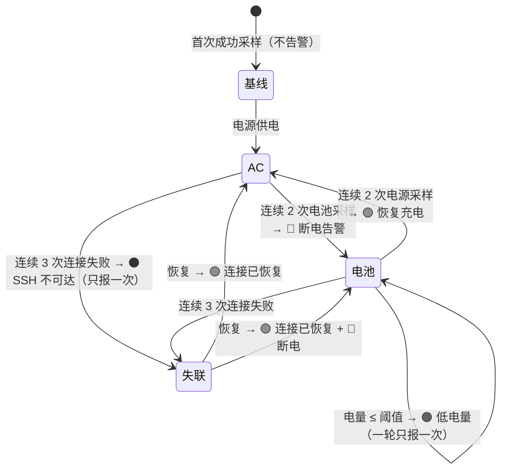

# BattMate ⚡🔋

**在菜单栏实时监控另一台 Mac 的充电状态 —— 充电器断开，1 分钟内知晓。**


一台 Mac 合盖当服务器 7×24 跑着，充电器接触不良、悄悄松脱，机器靠电池撑到耗尽关机，SSH 服务随之中断——而你毫无察觉。**BattMate 就是为这个场景写的**：在你的主力 Mac 菜单栏常驻一个图标，实时显示服务器机的充电状态，断电、低电量、失联立刻弹系统通知。

## 功能特性

- 📊 **菜单栏实时状态**：`⚡98` 绿（电源供电）/ `🔋45` 橙（电池供电）/ `⚠︎--` 灰（SSH 失联，失败期间闪烁）
- 🔔 **四类告警**（系统通知，同一状态只提醒一次，防骚扰）：
  - 🔴 充电器断开
  - 🟠 电量低于阈值（默认 20%，可配）
  - ⚫ SSH 连续 3 次连接失败
  - 🟢 恢复充电 / 连接恢复
- 🛡️ **防抖设计**：电源切换需连续 2 次采样确认——针对「接触不良」这种充电器在通断间抖动的故障模式，不会通知风暴
- 🚀 **轻量无感**：轮询走 SSH 连接复用，开销极低；主机睡眠自动暂停轮询、唤醒立即补测
- 📦 **部署即拷贝**：单个 `.app`，服务器机**零依赖**（`pmset` 系统自带，免 sudo）
- 💤 支持开机自启（SMAppService）

## 工作原理

```mermaid
flowchart LR
    subgraph A["主力 Mac（运行 BattMate）"]
        S[PollScheduler<br/>每 30s 触发] --> R[SSHBatteryReader<br/>ssh + 超时看门狗]
        R --> P[PMSetOutputParser<br/>解析 pmset 输出]
        P --> E[AlertEngine<br/>告警状态机 + 防抖]
        E --> N[Notifier<br/>系统通知]
        E --> U[StatusBarUI<br/>菜单栏图标]
        E --> J[(status.json<br/>为小组件预留)]
    end
    A -- "SSH (ControlMaster 复用)" -->|pmset -g batt| B[服务器 Mac<br/>合盖运行]
```

### 远端取数：一行 `pmset -g batt`

被监控机**不需要安装任何东西**。macOS 自带的 `pmset -g batt` 免 sudo 输出全部所需信息：

```
Now drawing from 'AC Power'
 -InternalBattery-0 (id=5400300)	98%; charging; 0:41 remaining until full
```

解析出：电源来源、电量百分比、充电/放电/已满、剩余时间。SSH 侧用 `BatchMode=yes`（绝不弹密码框）+ `ConnectTimeout=5` + `ControlMaster=auto/ControlPersist=60`（连接复用，后续轮询毫秒级）+ 12 秒看门狗（防悬挂）。

### 告警状态机（含防抖）



## 技术栈

| 层 | 选择 | 说明 |
|---|---|---|
| 语言 | Swift 5.8 | 单语言全栈 |
| 菜单栏 | AppKit `NSStatusItem` | 常驻图标 + 下拉菜单，LSUIElement 无 Dock 图标 |
| 设置界面 | SwiftUI `Form` | SSH 目标 / 轮询间隔 / 阈值 / 测试连接 |
| 通知 | `UNUserNotificationCenter` + `osascript` 兜底 | 双通道：UN 授权失败自动降级 AppleScript，转义经过单测 |
| 网络 | 系统 `ssh`（Process 调用） | 零第三方依赖，ControlMaster 复用连接 |
| 自启 | `SMAppService` | macOS 13+ 原生登录项 |
| 构建 | **swiftc 直编 + lipo** | 仅需 Command Line Tools，**不需要 Xcode** |
| 测试 | 自建轻量断言运行器 | `./test.sh` 一键编译运行 37 个单测，零警告 |

## 为什么这样设计（实现要点）

- **为什么是菜单栏而不是通知中心小组件？** WidgetKit 小组件刷新预算由系统控制，约 15~60 分钟才刷新一次——对「及时发现断电」完全不合格；且开发必须装 Xcode。菜单栏图标可秒级刷新、始终可见。状态数据仍落盘 `status.json`，为将来补小组件预留了数据接口。
- **为什么不用 SwiftPM？** 本项目开发机的 CLT 14.3.1 存在已知缺陷：缺少 `Platforms/MacOSX.platform`，SwiftPM 构建计划硬依赖的 `xcrun --show-sdk-platform-path` 在 CLT 模式下永不提供，`swift build`/`swift test` 一律硬失败且无升级可用。改用 `swiftc -sdk $(xcrun --show-sdk-path)` 直编，构建脚本两次编译（x86_64 + arm64 交叉编译）后 `lipo` 合并 universal 二进制，产物与 SwiftPM 构建无差别。
- **为什么零第三方依赖？** 一个菜单栏监控工具，保持 ~30MB 内存、单文件部署、新机器拷过去就能用，不值得引入任何包管理。
- **防抖为什么是 2 次采样？** 目标故障模式是「充电器接触不良」——电源会在通断间抖动。单次采样即告警会造成每 30 秒一对通知的风暴；连续 2 次同源采样确认（约 +30 秒延迟）可过滤全部抖动。
- **通知为什么要 osascript 兜底？** 未打包调试、UN 授权被拒、投递异常时，`display notification` 是 100% 可用的保底通道；正文换行/引号/反斜杠的 AppleScript 转义有专门单测。

## 构建

环境要求：**仅 Command Line Tools**（`xcode-select --install`），无需完整 Xcode。

```bash
./test.sh    # 运行全部 37 个单元测试
./build.sh   # 产物: build/BattMate.app（arm64 + x86_64 universal，ad-hoc 签名）
```

## 部署到监控机

1. 把 `build/BattMate.app` 拷到目标机（scp/AirDrop 均可；**微信/网盘传 .app 会损坏包结构**，请先 `zip -ry BattMate.zip BattMate.app` 再传），拖入「应用程序」
2. 首次打开：右键 → 打开（未公证 app 的 Gatekeeper 流程；若提示「已损坏」，终端执行 `xattr -cr /Applications/BattMate.app`）
3. 首次启动自动弹出设置窗口：
   - 填服务器机的 SSH 目标（如 `ya@192.168.1.50`）→ 点「测试连接」
   - 失败会给出可复制的 `ssh-copy-id <目标>` 命令，终端执行后重测
4. 保存后开始监控；建议在菜单勾选「开机自启动」

## 配置与数据文件

| 文件 | 路径 | 说明 |
|---|---|---|
| 配置 | `~/Library/Application Support/BattMate/config.json` | sshTarget / intervalSeconds (15~300，默认30) / lowBatteryThreshold (5~50，默认20) / soundEnabled / autostartEnabled |
| 状态 | `~/Library/Application Support/BattMate/status.json` | 最近一次检测结果（实时刷新） |
| 日志 | `~/Library/Application Support/BattMate/logs/battmate.log` | 每次检测与全部告警 |

## 故障排查

| 现象 | 处理 |
|---|---|
| 图标一直灰 `⚠︎--` | 终端手动 `ssh <目标> pmset -g batt` 验证；Permission denied → 执行 `ssh-copy-id <目标>` |
| 不弹通知 | 系统设置 → 通知 → BattMate → 允许通知 |
| 提示「已损坏」 | `xattr -cr /Applications/BattMate.app` |
| 提示「不支持此应用程序」 | 传输损坏（常见于微信/网盘传 .app），重新用 zip 打包传输 |

## 项目结构

```
Sources/BattMateCore/     # 全部业务逻辑（37 个单测覆盖）
  PowerState.swift          状态模型
  PMSetOutputParser.swift   pmset 输出解析
  SSHBatteryReader.swift    SSH 取数 + 超时看门狗
  AlertEngine.swift         告警状态机（防抖）
  PollScheduler.swift       轮询调度（睡眠暂停/唤醒补测）
  Notifier.swift            通知双通道
  SettingsStore.swift       配置持久化
  StatusReport.swift        status.json 落盘
  StatusTitleFormatter.swift 图标文本/颜色
  Autostart.swift           开机自启
Sources/BattMate/         # 壳层
  main.swift                入口
  AppController.swift       组装与数据流
  StatusBarUI.swift         NSStatusItem 菜单栏
  SettingsWindow.swift      SwiftUI 设置窗口
Tests/                    # 自建断言运行器 + 测试
docs/superpowers/specs/   # 设计文档
docs/superpowers/plans/   # 实施计划
build.sh / test.sh        # 构建与测试脚本
```

## FAQ

**Q: 服务器机需要装什么？**
A: 什么都不用装。`pmset` 是 macOS 自带命令，免 sudo。

**Q: 会拖慢我的 Mac 吗？**
A: 不会。每 30 秒一次 SSH 复用连接的轻量调用 + 一次文本解析，内存占用约 30MB。

**Q: 主力机睡眠了会漏告警吗？**
A: 睡眠期间轮询自动暂停，唤醒瞬间立即补测一次。你不在电脑前时本来也看不到通知。

**Q: 支持监控多台机器吗？**
A: 当前版本一台（MVP）。`status.json` 的数据接口已按可扩展结构设计，多机支持在 Roadmap。

## Roadmap

- [ ] 通知中心小组件（WidgetKit）——数据接口已预留
- [ ] 多台服务器机监控
- [ ] 历史电量曲线
- [ ] Homebrew Cask 分发

## 设计文档

完整的需求调研、方案取舍与实施计划见 [`docs/superpowers/`](docs/superpowers/specs/)：
[设计文档](docs/superpowers/specs/2026-10-22-battmate-remote-battery-monitor-design.md) · [实施计划](docs/superpowers/plans/2026-10-22-battmate.md)

## License

[MIT](LICENSE)
